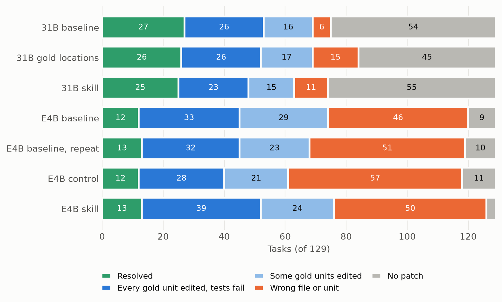

# Right Place, Wrong Patch: A Failure Anatomy of Gemma 4 Developer Agents, Measured with Function-Level Edit Labels

## Abstract

We ask why Gemma 4 agents fail the tasks of this competition and answer with a measuring instrument: Where-to-Edit, function-level labels of where the reference fix lands for all 129 public competition tasks and, with the same script, for the 500 tasks of SWE-bench Verified. Labeling every agent patch with that script sorts each unresolved task into no patch, wrong place, partial coverage, or full coverage with failing tests. Across seven runs under a public prompt's budget of 28 tool calls and 8 minutes, the two models fail differently. Gemma 4 31B resolves 25–27 tasks, hits the time limit in 72–78 and ends 45–55 with no patch. Its edit placement is already good: handing it the gold files and functions through a skill call leaves it at 26 resolved. E4B resolves 12–13, patches almost every task, puts 46–57 patches in the wrong place, and when it edits every gold unit its tests pass in 20–31% of cases against 46–50% for 31B. Both models solve small fixes: 31 of the 73 tasks whose reference fix changes at most 15 lines were solved at least once, against 4 of the 56 larger ones. Two identical runs differ on 5 solved tasks, which bounds what a single public-set comparison can show.

## 1. Introduction

The Gemma 4 Developer Agent competition asks an agent built from Gemma 4 and Google's Agent Development Kit (ADK) to resolve real pull-request tasks in Python repositories. Each task runs offline under a budget of tool calls and minutes, and hidden tests judge the patch. Public work concentrates on prompts and on helping the model find the code to change: the strongest public prompt we inspected tells the model to search for the exact names in the task, and the organisers ship a call graph and symbol embeddings per task.

We began on the same path. We labeled where each reference fix lands, built the best model-free localizer we could, and packaged it as an ADK skill. Resolution stayed flat on both models. The labels then became the instrument that explains this result: applied to agent patches, they show where each failed task stopped.

Contributions:

1. **An instrument.** Where-to-Edit labels the edited files, functions, methods and classes for the 129 public tasks and for SWE-bench Verified, and one script assigns every agent patch an outcome class.
2. **A failure anatomy.** Seven 129-task runs of two Gemma 4 sizes, classified task by task: 31B is bounded by time, E4B by edit placement and by the content of the fix.
3. **A localization ceiling.** Three information levels through one skill call (none, BM25, gold locations) leave resolution unchanged.
4. **Limits on what a participant can gain or measure.** Solved tasks are the small ones, tasks whose tests call an identifier the fix must introduce are solved in 6 of 210 attempts, and identical runs disagree on 5 solved tasks.

## 2. Related Work

SWE-bench [1] evaluates language models on real GitHub issues with hidden tests, and SWE-bench Verified [2] is its human-validated subset. SWE-agent [3] showed that the agent–computer interface changes success rates. Agentless [4] separates hierarchical localization from repair, LocAgent [5] lets an LLM traverse a code graph and reports that better localization improves resolution, and SweRank [6] trains retrieve-and-rerank models for issue localization. Classical bug localization ranked files against bug reports with vector-space models [7]. We use BM25 [8], reciprocal rank fusion [9] and bootstrap confidence intervals [10]. Our measurement complements these systems: for small open models under a fixed budget, it sizes the share of failures that localization can reach.

## 3. The Where-to-Edit Labels

**Sources.** The competition's public file has 129 tasks: 67 from `fastapi/fastapi`, 48 from `Textualize/rich`, 13 from `psf/requests` and 1 from `encode/httpx`. The task text is a pull request's title and body (median 41 content tokens) and `hints_text` is empty. SWE-bench Verified has 500 tasks from 12 repositories; we use the issue text alone.

**Procedure.** `build_labels.py` parses a patch into deleted lines and insertion points, parses each edited file at the base commit with Python's `ast` module into definition units (top-level functions, classes, and methods; a nested function belongs to its parent), and credits every changed line to its innermost unit. A class receives credit only for edits outside its methods. Module-level edits count toward the file. Candidates are Python files outside test, documentation, example, benchmark, build and hidden directories.

| Property | Competition | SWE-bench Verified |
|---|---|---|
| Tasks | 129 | 500 |
| Tasks with an edited source file | 125 | 500 |
| Tasks with an edited unit | 119 | 485 |
| Edited units | 501 | 952 |
| Median changed lines | 11 | 7 |
| Text names an edited unit | 35 of 119 (29%) | 231 of 485 (48%) |
| Text names an edited file | 10 of 125 (8%) | 132 of 500 (26%) |

A unit or file counts as named when its name appears in the text as a whole word.

## 4. Runs and Outcome Classes

**Runs.** Each run covers the 129 public tasks in a Kaggle notebook with four L4 GPUs and the organisers' harness, eight tasks in parallel; the timing results belong to this hardware. The baseline is a public prompt with its own budget file: 28 tool calls and 8 minutes per task. Gemma 4 E4B ran four configurations: the baseline, an identical repeat, the baseline plus our localization skill (Section 6), and a control whose skill call returns zero repository information. The control is the skill's first build, whose implementation error indexed ADK's temporary script directory instead of the repository; we adopted that run as a control after finding the error. Gemma 4 31B ran three: the baseline, the skill, and a gold-location variant whose skill call prints the labeled gold files and units in the skill's output format.

**Outcome classes.** The script that labels gold patches labels each agent patch, and the first matching class applies:

- **Resolved**: the hidden tests pass.
- **No patch**: the working tree is unchanged.
- **Wrong place**: the patch touches no gold file, or no gold unit.
- **Partial**: it touches some gold files and units.
- **Covered, failing**: it touches every gold file and unit, and tests fail. The 4 tasks whose fix only adds files enter this class with any patch.

From the traces we read the stop reason, the time of the first source edit, and whether tests ran after the last edit.

## 5. Failure Anatomy

### 5.1 Two models, two failure profiles

| Run | Resolved | No patch | Wrong place | Partial | Covered, failing | Time limit hit |
|---|---|---|---|---|---|---|
| E4B baseline | 12 | 9 | 46 | 29 | 33 | 6 |
| E4B baseline, repeat | 13 | 10 | 51 | 23 | 32 | 7 |
| E4B control | 12 | 11 | 57 | 21 | 28 | 3 |
| E4B skill | 13 | 3 | 50 | 24 | 39 | 7 |
| 31B baseline | 27 | 54 | 6 | 16 | 26 | 72 |
| 31B skill | 25 | 55 | 11 | 15 | 23 | 77 |
| 31B gold locations | 26 | 45 | 15 | 17 | 26 | 78 |



*Figure 1. Outcome of every task in every run; counts are in `figures/fig_outcomes_data.json`.*

**31B fails before it edits.** In the 31B baseline, 54 of the 102 unresolved tasks have no patch, and 6 of its 75 patches (8% [3%, 15%]) land in the wrong place.

**E4B edits everywhere.** E4B submits 118–126 patches per run, and 38–48% of them land in the wrong place. A further 28–39 tasks per run reach every gold unit and still fail.

**Reaching the right place converts at half the rate on E4B.** A patch that touches every gold file and unit resolves the task in 8 of 37, 10 of 38, 11 of 36 and 9 of 45 cases across the E4B runs, and in 21 of 46, 22 of 44 and 21 of 46 cases for 31B.

**Resolved patches reproduce the reference fix.** The median identifier overlap between the lines an agent adds and the lines the reference adds is at least 0.72 for resolved patches in every run and 1.0 in four. Covered, failing patches overlap at 0.19–0.53: they have the reference's location and size (median line ratio 0.83–1.36) and different content.

**The agent's own test run gives little signal.** E4B runs tests after its last edit in 105–116 tasks per run and resolves 12–13. For 36–44 E4B patches and 20–26 31B patches per run, pytest stops at collection (exit code 2): the test module fails to import.

### 5.2 31B: time is the binding budget

The three 31B runs hit the 8-minute limit in 72, 77 and 78 tasks. In 46, 45 and 41 of them the agent never edits a source file, and 57, 60 and 61 end with fewer than 28 calls used: the clock runs out before the call budget. 31B makes its first source edit at a median 265, 247 and 245 s; E4B at 74–80 s. A 31B run without a source edit never resolves (0 of 144 run-tasks).

Early edits go with success. Pooled over the three runs, 31B resolves 36 of 76 tasks when the first edit comes before 180 s and 20 of 90 from 300 s on. Among tasks with small reference fixes the same split gives 35 of 62 against 18 of 56. The 3 tasks that only E4B ever solved end with no 31B patch in 8 of 9 attempts.

### 5.3 Which tasks are within reach

**Small fixes.** 35 tasks were solved at least once in the seven runs, and 30 of them have a reference fix of at most 12 changed source lines (median 4, against 17.5 for never-solved tasks). Splitting at 15 lines, 31 of 73 small tasks were solved at least once (42% [32%, 53%]) and 4 of 56 larger ones (7% [2%, 14%]). Of the 21 tasks whose fix spans five or more units or new files, 1 was solved.

**New interfaces.** In 30 tasks the tests use an identifier that the reference fix introduces and the base commit lacks. The task text spells out all such identifiers in 5 of them. These 30 tasks were resolved in 6 of 210 run-task attempts.

**Model gap.** 31B solved 32 tasks at least once, E4B 22, and 19 are shared. On the 13 tasks only 31B solved, E4B's 52 attempts end in the wrong place 23 times, covered and failing 19 times, and partial 9 times: the gap is split between placement and the fix itself.

### 5.4 The noise floor

The two identical E4B runs resolve 12 and 13 tasks and share 10: 3 solved tasks appear and 2 disappear. Gold-file edits flip in 30 tasks (14 gained, 16 lost), and 89 of 129 tasks keep their outcome class. Over the four E4B runs, 7 tasks are solved every time, 15 sometimes and 107 never; over the three 31B runs, 20 every time and 12 sometimes. A single-run difference of five solved tasks sits inside this variation.

## 6. Localization: Offline Gains, Flat Resolution

### 6.1 Seven model-free localizers on two benchmarks

All localizers are deterministic and live in one standard-library file, `locate.py`, with parameters fixed before evaluation (BM25 k1 = 1.2, b = 0.75; graph weight λ = 0.5; RRF k = 60). Grep is the public-prompt strategy: rank the files and units that define or mention identifiers extracted from the task. BM25 indexes whole files or single definition units. BM25 + graph adds λ times the best score among a unit's callers and callees in an AST call graph. The remaining three are a size prior, RRF of all rankings, and a cascade that puts named definitions first. Hit@k is the share of tasks with an edited file or unit in the top k. Intervals are 95% percentile intervals from 10,000 bootstrap resamples of tasks, and differences are paired.

| Method | Comp. File Hit@1 | Comp. Func Hit@10 | SWE-V File Hit@1 | SWE-V Func Hit@10 |
|---|---|---|---|---|
| Grep (public-prompt strategy) | 0.360 | 0.471 | 0.420 | 0.476 |
| BM25 over files | 0.288 | 0.176 | 0.438 | 0.186 |
| BM25 over functions | 0.456 | 0.555 | 0.480 | 0.643 |
| BM25 + graph (skill) | 0.472 | 0.555 | 0.482 | 0.633 |

Function-level BM25 beats grep on function Hit@10 by +0.084 [+0.008, +0.160] on the competition tasks and +0.167 [+0.124, +0.210] on SWE-bench Verified. Titles name the public API and the fix lives behind it: in 31 of the 62 competition tasks that spell out a repository definition, none of the named definitions is edited. When the text names an edited unit, grep reaches 0.943 and BM25 + graph 0.914 (35 tasks); on the remaining 84 tasks grep falls to 0.274 and BM25 + graph holds 0.405.

### 6.2 Entering the organisers' graphs and embeddings

Each task ships a call graph and one 256-dimensional vector per symbol, and both tools take a symbol name as input. We aligned 466 of 501 edited units (93%) with graph nodes. Seeding the tools with the top three BM25 units instead of the definitions named in the task raises the share of tasks where an edited unit is reached by +0.210 [+0.118, +0.311]. Reading the same number of units straight down the BM25 list reaches +0.193 [+0.109, +0.286] more than the tool expansion: the embeddings encode which code resembles which code, and localization needs the request in the same space.

### 6.3 Three information levels inside the agent

One call, `run_skill_script(skill_name="where-to-edit", file_path="scripts/locate.py", args={"repo": "/workspace", "query": "<task text>"})`, prints the top 8 files and the top 12 units as `path:start-end qualname` in about a second on a laptop CPU.

**E4B, none versus BM25.** The model called the skill in 120 tasks. Against the control, edits move onto a gold file in 23 tasks and off it in 5 (+0.144 [+0.064, +0.224]); resolution moves by 6 gained and 5 lost. Against the two baseline runs the gold-file change is +0.064 [−0.016, +0.144] and +0.080 [−0.008, +0.168], inside the repeat variation of Section 5.4.

**31B, BM25 versus baseline.** The model called the skill in 92 tasks. Gold-file edits change by 17 gained and 18 lost, resolution by 4 gained and 6 lost.

**31B, gold versus baseline.** The model called the gold-location skill in 96 tasks, and the returned list contained a gold unit in 85. Gold-file edits change by 20 gained and 11 lost (+0.072 [−0.016, +0.160]); resolution changes by 3 gained and 4 lost.

Section 5 explains all three. 31B places 82–92% of its patches correctly in every run, its failures sit in time and in fix content, and perfect location information reaches neither. E4B gains placement and then converts covered patches at 20–31%.

## 7. Where the Budget Should Go

- **31B: buy time to the first edit.** The 8-minute limit is the submission's own setting, and 72–78 tasks hit it. Raise `max_time_minutes` as far as the total runtime allows, cap reasoning length, and set the edit deadline in seconds.
- **Stop investing in localization for 31B.** Gold locations return 26 resolved tasks against 27 for the baseline.
- **E4B: placement aids help placement.** Resolution needs a better fix at the right place, where E4B converts at about half of 31B's rate.
- **Triage by size.** Tasks with fixes above 15 lines return 4 solved tasks from 56. A prompt that targets one small, complete edit matches the tasks within reach.
- **Compare with repeats.** Treat a difference under five solved tasks between single 129-task runs as noise.

## 8. Reproducibility

The release contains both label sets, per-task ranks, the skill, the per-run outcome record of every task, and every script. `analyze_failures.py` rebuilds Section 5 from run folders, and

```
python -I scripts/reproduce_numbers.py
```

recomputes each number in this writeup and fails if a number in the text lacks a check.

## References

[1] C. E. Jimenez, J. Yang, A. Wettig, et al. SWE-bench: Can Language Models Resolve Real-World GitHub Issues? ICLR 2024.
[2] N. Chowdhury, J. Aung, C. J. Shern, et al. Introducing SWE-bench Verified. OpenAI, 2024.
[3] J. Yang, C. E. Jimenez, A. Wettig, et al. SWE-agent: Agent-Computer Interfaces Enable Automated Software Engineering. NeurIPS 2024.
[4] C. S. Xia, Y. Deng, S. Dunn, L. Zhang. Agentless: Demystifying LLM-based Software Engineering Agents. arXiv:2407.01489, 2024.
[5] Z. Chen, X. Tang, G. Deng, et al. LocAgent: Graph-Guided LLM Agents for Code Localization. arXiv:2503.09089, 2025.
[6] R. G. Reddy, T. Suresh, J. Doo, et al. SweRank: Software Issue Localization with Code Ranking. arXiv:2505.07849, 2025.
[7] J. Zhou, H. Zhang, D. Lo. Where Should the Bugs Be Fixed? More Accurate Information Retrieval-Based Bug Localization Based on Bug Reports. ICSE 2012.
[8] S. Robertson, H. Zaragoza. The Probabilistic Relevance Framework: BM25 and Beyond. Foundations and Trends in Information Retrieval, 2009.
[9] G. V. Cormack, C. L. A. Clarke, S. Büttcher. Reciprocal Rank Fusion Outperforms Condorcet and Individual Rank Learning Methods. SIGIR 2009.
[10] B. Efron, R. J. Tibshirani. An Introduction to the Bootstrap. Chapman & Hall, 1993.
